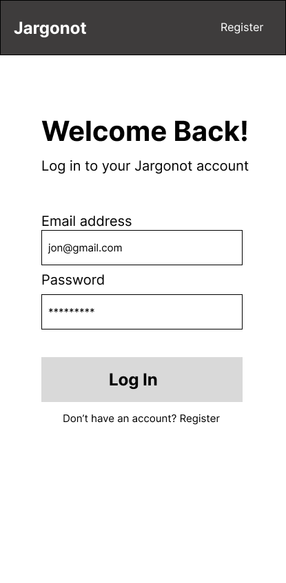
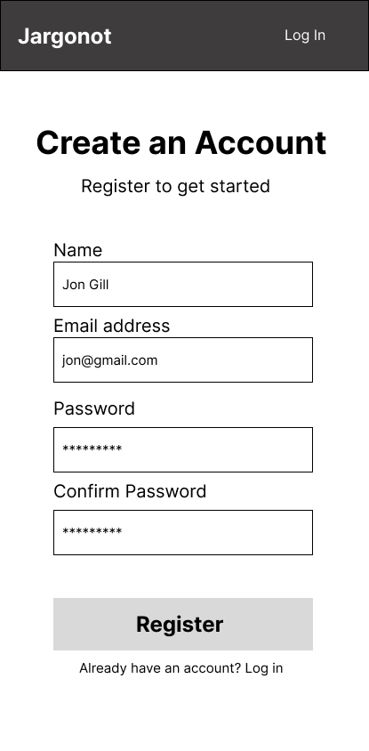
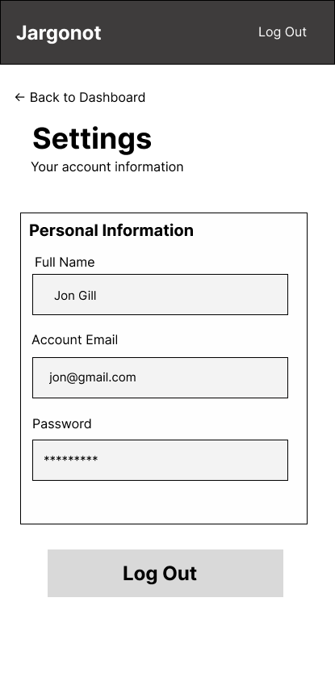

# User Experience Design

# Jargonot — UX Design

## Overview

Jargonot is a mobile web application designed to make
news articles and research papers more accessible to
students by simplifying technical jargon and explaining
complex concepts.

## App Map

The app map illustrates how users navigate between
the different screens of Jargonot.

<!-- App map image to  be added here -->

## Wireframes

### 1. Login Screen

The Login screen allows existing users to sign in
to their Jargonot accounts.

### 2. Registration Screen

The Registration screen allows new users to create a Jargonot account by entering their name, email address, password, and password confirmation.

Users who already have an account can navigate to the Login screen using the login link.

### 3. My Dashboard

The Dashboard serves as the user's central hub for accessing their Jargonot account features.

From this screen, users can:

- Access their saved research papers through **My Favourites**.
- Browse available research papers using **Browse Papers**.
- Manage their account information and preferences through **Settings**.

### 4. My Favourites

The My Favourites screen displays research papers that the user has previously saved for future reference.

Each saved paper appears with its title and relevant information. Users can select a paper to read it or remove it from their favourites.

This feature allows users to return to interesting research without having to search for the same articles again.

### 5. Settings

The Settings screen allows users to view and manage their account information.

Users can access their personal details, including their full name, email address, and password.

The screen also provides a **Log Out** button to securely end the user's session, along with a link to return to the Dashboard.

