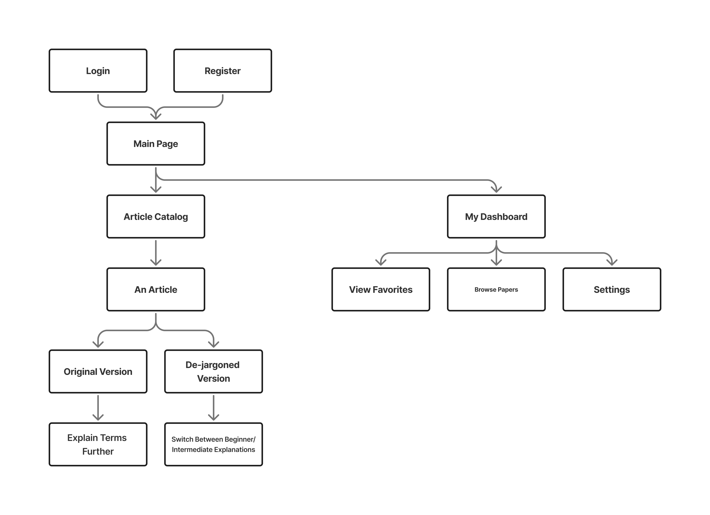
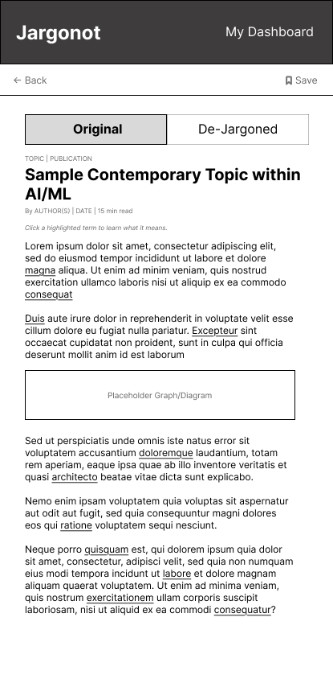
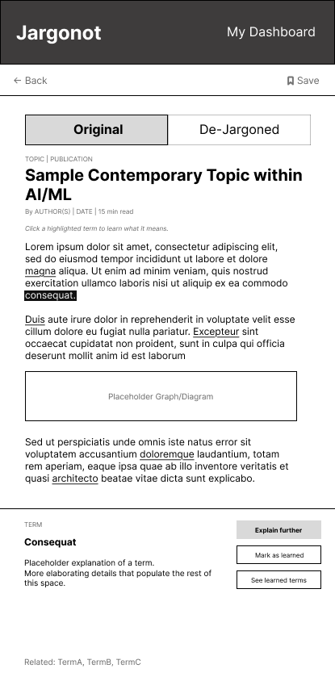
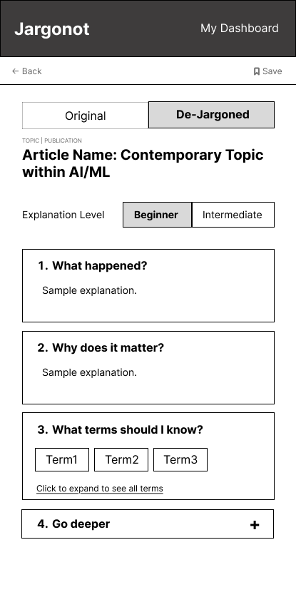
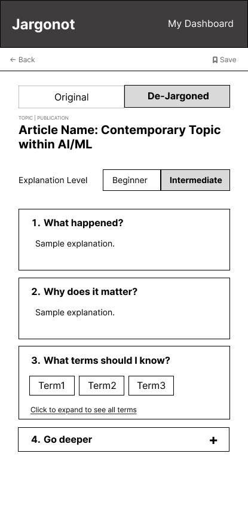

# User Experience Design

# Jargonot — UX Design

## Overview

Jargonot is a mobile web application designed to make
news articles and research papers more accessible to
students by simplifying technical jargon and explaining
complex concepts.

## Interactive Prototype

[View the Jargonot Interactive Prototype](https://www.figma.com/design/iMa4u6Mi9Vpq5OBIjp22u0/Jargonot---Sprint-0-Prototype?t=FYwsODxmOd2CdPmb-1)

## App Map

The app map illustrates how users navigate between
the different screens of Jargonot.

## Wireframes

### 1. Login Screen

The Login screen allows existing users to sign in
to their Jargonot accounts.

### 2. Registration Screen

The Registration screen allows new users to create a Jargonot account by entering their name, email address, password, and password confirmation.

Users who already have an account can navigate to the Login screen using the login link.

### 3. Main Page

The Main Page is the first screen users see after logging in or registering. Clicking **Jargonot** on the top left of every screen directs every user here.

From this screen, users can:

- Search for a topic or article using the **search bar** (e.g. AI/ML, Cybersecurity).
- Search topics they follow through **Your Topics**, or add a new topic with the **+** button.
- Read a featured article in **Today's Pick**, which shows the article's topic, publication, estimated reading time, title, and a short preview with a **Read Article** link.
- View the full list of articles with the **Browse All Articles** button, which opens the Article Catalog.

The **My Dashboard** link in the header is available on every signed-in screen.

### 4. Article Catalog

The Article Catalog lets users browse and search all articles available in Jargonot.

Users can:

- Search articles by topic, keyword, or term.
- Filter the list by topic available via buttons.
- Scan each article/publication card, which shows a thumbnail, the article's topic and publication, its title, and its keywords. Selecting a card opens the article.

### 5. Article — Original Version

The article screen opens in the **Original** view, which shows the article as it was published. A toggle at the top lets users switch between the **Original** and **De-Jargoned** versions.

The article header shows the topic, publication, title, author(s), publication date, and estimated reading time. Technical terms in the body text are underlined.

The top bar provides a **Back** link to the previous screen and a **Save** button that adds the article to the user's favourites.

### 6. Article — Term Explanation

When a user taps an underlined term in the Original view, the term is highlighted and an explanation panel opens at the bottom of the screen. Users can look up unfamiliar jargon without leaving the article.

The panel shows the term and a plain-language explanation, along with these actions:

- **Explain further** gives a more detailed explanation of the term.
- **Mark as learned** records that the user now understands the term.
- **See learned terms** opens the list of terms the user has already learned.

Related terms are listed at the bottom of the panel so users can explore connected concepts.

### 7. Article — De-Jargoned Version (Beginner)

The **De-Jargoned** view replaces the original text with a simplified summary of the article. An **Explanation Level** toggle lets users choose how much background knowledge the explanation assumes. The **Beginner** level is aimed at readers who are new to the topic.

The summary is organized into four sections:

1. **What happened?** gives a plain-language summary of the article's main findings, introducing simple terms.
2. **Why does it matter?** explains the significance and real-world impact.
3. **What terms should I know?** lists key terms, with a link to expand the full list of terms.
4. **Go deeper** is a collapsible section with additional detail for users who want to learn more.

### 8. Article — De-Jargoned Version (Intermediate)

The **Intermediate** level has the same four-section layout as the Beginner level, but its explanations are written for readers who already have some familiarity with the subject. They go into more technical detail and will assume knowledge of beginner terms.

Users can switch between Beginner and Intermediate at any time, which lets them move to more advanced explanations as their understanding grows.

### 9. My Dashboard

The Dashboard serves as the user's central hub for accessing their Jargonot account features.

From this screen, users can:

- Access their saved research papers through **My Favourites**.
- Browse available research papers using **Browse Papers**.
- Manage their account information and preferences through **Settings**.

### 10. My Favourites

The My Favourites screen displays research papers that the user has previously saved for future reference.

Each saved paper appears with its title and relevant information. Users can select a paper to read it or remove it from their favourites.

This feature allows users to return to interesting research without having to search for the same articles again.

### 11. Settings

The Settings screen allows users to view and manage their account information.

Users can access their personal details, including their full name, email address, and password.

The screen also provides a **Log Out** button to securely end the user's session, along with a link to return to the Dashboard.

